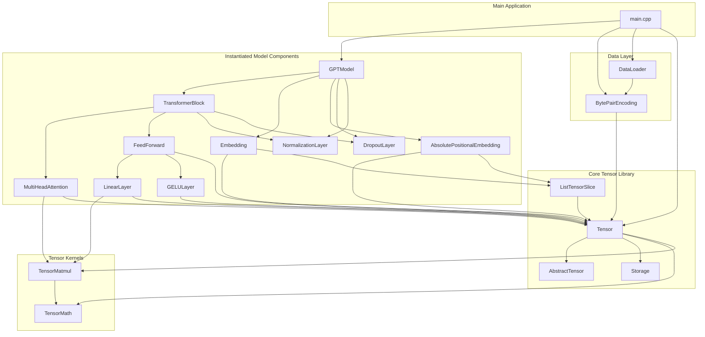

# build-llm-cpp

An exploration of building a large language model in C++.

## High-Level Architecture (GPTModel Instantiation Path)



## Detailed Class Dependencies

### Core Tensor Hierarchy
```
Storage<T> ──used by──▶ Tensor<T>
Tensor<T> ──uses──▶ TensorMath<T>
Tensor<T> ──uses──▶ TensorMatmul<T>
```

### GPTModel Instantiation Chain
```
GPTModel
├── Embedding (token embeddings)
├── AbsolutePositionalEmbedding (position embeddings)
├── DropoutLayer
├── NormalizationLayer
└── TransformerBlock (repeated N times)
    ├── MultiHeadAttention
    │   └── uses TensorMatmul for QKV operations
    ├── FeedForward
    │   ├── LinearLayer (scale up)
    │   ├── GELULayer (activation)
    │   └── LinearLayer (scale down)
    └── NormalizationLayer + DropoutLayer (shortcut connections)
```

### Data Flow
```
BytePairEncoding (tokenizer)
    ↓
DataLoader (creates batches)
    ↓
Tensor<size_t> (input tokens)
    ↓
GPTModel.forward()
    ↓
Tensor<float> (logits output)
```

## File Structure

### Header Files (include/)
- **Core**: Tensor.hpp, Storage.hpp, AbstractTensor.hpp
- **Model**: Model.hpp, GPTModel.hpp, TransformerBlock.hpp
- **Layers**: MultiHeadAttention.hpp, FeedForward.hpp, LinearLayer.hpp
- **Activations**: GELULayer.hpp, NormalizationLayer.hpp, DropoutLayer.hpp
- **Embeddings**: Embedding.hpp, AbsolutePositionalEmbedding.hpp
- **Data**: DataLoader.hpp, BytePairEncoding.hpp
- **Utilities**: Log.hpp, Numerics.hpp, TensorMath.hpp, TensorMatmul.hpp

### Source Files (src/)
- main.cpp, GPTModel.cpp, DataLoader.cpp, BytePairEncoding.cpp, Log.cpp

## Key Dependencies Summary

1. **Core Tensor Library**: `Tensor<T>` with `Storage<T>` for memory management
2. **GPTModel Composition**: `TransformerBlock` × N, `Embedding`, `AbsolutePositionalEmbedding`, `Dropout`, `Normalization`
3. **TransformerBlock**: `MultiHeadAttention` + `FeedForward` with layer normalization and dropout
4. **Attention**: QKV projection using `TensorMatmul` with causal masking
5. **FeedForward**: Linear → GELU → Linear with residual connections
6. **Data Pipeline**: `BytePairEncoding` tokenizer → `DataLoader` → `Tensor` batches

## How to build

This project uses `bazel` to build. For debugging purposes, build with:
```
bazel build --config debug //... 
```

Using the debug mode disables optimizations, turns on debug symbols, and uses address sanitizer checks.

A properly optimized, vectorized build is available with either:
```
bazel build --config vectorize //...
```
or
```
bazel build --config release //...
```

`build-llm-cpp` will be produced in `bazel-bin/`.

For running matmul benchmarks, use: `matmul-benchmark` in `bazel-bin/`.

## GPT Inference

A GPT2-like model is now available in `build-llm-cpp`. See `main.cpp` for configuring inference. Executing the main binary produces a batched inference output.

## Training

As of now, no backward pass has been implemented yet. This is the next action item.

## Unit tests

Unit tests are available in the `tests/` directory and are buildable in `bazel` via:
```
bazel test --config debug //...
```

## AI usage in this project

The primary goal of this exploration into low-level model training is to properly absorb the concepts and understand
more of the pitfalls involved in designing such a solution. As such, this project is nearly AI-free; however,
I feel compelled to disclose that unit tests and functions designated with:
```
DISCLAIMER: AI tools were used
```
in the docstring, include AI usage.

For functions without this designation (or files without my usual andersensam header), it is safe to assume
that AI was not used in the neither the design nor implementation.
