# build-llm-cpp

An exploration of building a large language model in C++.

## High-Level Architecture

```mermaid
graph TD
    subgraph "Main Application"
        main[main.cpp]
    end

    subgraph "Interfaces"
        abstract_embedding[AbstractEmbedding.hpp]
        abstract_tensor[AbstractTensor.hpp]
        attention[Attention.hpp]
        layer[Layer.hpp]
        model[Model.hpp]
        tokenizer[Tokenizer.hpp]
    end
    
    subgraph "Model Layer"
        gpt[GPTModel.hpp]
    end
    
    subgraph "Core Tensor Library"
        storage[Storage.hpp]
        tensor[Tensor.hpp]
        diminfo[DimInfo.hpp]
        slice_config[SliceConfig.hpp]
        list_slice[ListTensorSlice.hpp]
    end

    subgraph "Tensor Kernels"
        tensor_math[TensorMath.hpp]
        tensor_matmul[TensorMatmul.hpp]
        numerics[Numerics.hpp]
    end
    
    subgraph "Transformer Components"
        transformer[TransformerBlock.hpp]
        mha[MultiHeadAttention.hpp]
        feedforward[FeedForward.hpp]
        linear[LinearLayer.hpp]
    end
    
    subgraph "Specialized Layers"
        norm[NormalizationLayer.hpp]
        dropout[DropoutLayer.hpp]
        gelu[GELULayer.hpp]
    end
    
    subgraph "Embedding & Tokenization"
        embedding[Embedding.hpp]
        bpe[BytePairEncoding.hpp]
        abs_pos[AbsolutePositionalEmbedding.hpp]
    end
    
    subgraph "Data Handling"
        dataloader[DataLoader.hpp]
    end
    
    subgraph "Utilities"
        log[Log.hpp]
        tensor_utils[TensorUtils.hpp]
    end

    %% Main application dependencies
    main --> gpt
    main --> bpe
    main --> dataloader
    main --> tensor
    main --> log
    
    %% Model layer dependencies
    model --> abstract_tensor
    model --> tensor
    gpt --> model
    gpt --> transformer
    gpt --> embedding
    gpt --> abs_pos
    gpt --> dropout
    gpt --> norm
    
    %% Transformer block dependencies
    transformer --> layer
    transformer --> mha
    transformer --> feedforward
    transformer --> norm
    transformer --> dropout
    transformer --> abstract_tensor
    transformer --> tensor
    
    %% MultiHeadAttention dependencies
    mha --> attention
    mha --> abstract_tensor
    mha --> tensor
    mha --> tensor_matmul
    attention --> abstract_tensor
    attention --> layer
    attention --> tensor
    
    %% FeedForward dependencies
    feedforward --> layer
    feedforward --> linear
    feedforward --> gelu
    feedforward --> abstract_tensor
    feedforward --> tensor
    
    %% Layer interface dependencies
    layer --> abstract_tensor
    layer --> tensor
    layer --> tensor_math
    
    %% Tensor library dependencies
    tensor --> abstract_tensor
    tensor --> storage
    tensor --> log
    tensor --> numerics
    tensor --> tensor_math
    tensor --> tensor_matmul
    tensor --> tensor_utils
    slice_config --> abstract_tensor
    slice_config --> tensor
    slice_config --> diminfo
    list_slice --> abstract_tensor
    list_slice --> tensor
    
    %% TensorMath dependencies
    tensor_math --> numerics
    
    %% Specialized layer dependencies
    norm --> layer
    norm --> abstract_tensor
    norm --> tensor
    norm --> tensor_math
    
    dropout --> layer
    dropout --> abstract_tensor
    dropout --> tensor
    
    gelu --> layer
    gelu --> abstract_tensor
    gelu --> tensor
    gelu --> tensor_math
    
    abs_pos --> abstract_tensor
    abs_pos --> tensor
    
    %% Embedding dependencies
    embedding --> abstract_embedding
    embedding --> abstract_tensor
    embedding --> tensor
    embedding --> storage
    abstract_embedding --> list_slice
    abstract_embedding --> tensor
    
    %% BPE tokenizer dependencies
    bpe --> tokenizer
    bpe --> slice_config
    
    %% Data loader dependencies
    dataloader --> bpe
    dataloader --> slice_config
    dataloader --> abstract_tensor
    dataloader --> tensor
        
```



## Detailed Class Dependencies

### Core Tensor Hierarchy
```
Storage<T> ──used by──▶ AbstractTensor<T>
AbstractTensor<T> ──inherited by──▶ Tensor<T>
AbstractTensor<T> ──inherited by──▶ ListTensorSlice<T>
Tensor<T> ──has──▶ Storage<T> (via shared_ptr)
Tensor<T> ──uses──▶ TensorMath<T>
Tensor<T> ──uses──▶ TensorMatmul<T>
Tensor<T> ──uses──▶ TensorUtils<T>
```

### Layer Architecture
```
Layer<T> (interface)
    │
    ├──▶ NormalizationLayer<T>
    │       └── uses TensorMath for operations
    │
    ├──▶ DropoutLayer<T>
    │       └── uses Tensor for dropout operations
    │
    ├──▶ GELULayer<T>
    │       └── uses TensorMath for GELU activation
    │
    ├──▶ LinearLayer<T>
    │       └── uses Tensor for linear transformations
    │
    ├──▶ Attention<T> (interface)
    │       │
    │       └──▶ MultiHeadAttention<T>
    │               └── uses TensorMatmul for QKV operations
    │
    └──▶ FeedForward<T>
            └── uses LinearLayer and GELULayer
```

### Model Architecture
```
Model<T> (interface)
    │
    └──▶ GPTModel
            ├── uses TransformerBlock
            ├── uses Embedding
            ├── uses AbsolutePositionalEmbedding
            └── uses NormalizationLayer
```

### Data Flow
```
BytePairEncoding ──used by──▶ DataLoader
DataLoader ──creates──▶ Tensor<size_t> (input batches)
Tensor ──used by──▶ GPTModel.forward()
GPTModel ──produces──▶ Tensor<float> (logits)
```

## File Structure

### Header Files (include/)
- `AbstractTensor.hpp` - Base interface for tensor operations
- `Storage.hpp` - Memory storage wrapper
- `Tensor.hpp` - Core tensor implementation
- `Model.hpp` - Model interface
- `TransformerBlock.hpp` - Transformer block implementation
- `MultiHeadAttention.hpp` - Multi-head attention mechanism
- `FeedForward.hpp` - Feed-forward network layers
- `Embedding.hpp` - Token embedding layer
- `BytePairEncoding.hpp` - BPE tokenizer
- `DataLoader.hpp` - Data loading functionality
- And more utility classes...

### Source Files (src/)
- `main.cpp` - Application entry point
- `GPTModel.cpp` - GPT model implementation
- `DataLoader.cpp` - Data loader implementation
- `BytePairEncoding.cpp` - BPE tokenizer implementation
- `Log.cpp` - Logging utilities
- And more...

## Key Dependencies Summary

1. **Core Tensor Library**: Built on `AbstractTensor` → `Tensor` hierarchy with `Storage` for memory management
2. **Layer System**: Interface-based architecture with `Layer<T>` as the base for all neural network layers
3. **Transformer Components**: Modular design with `TransformerBlock` composed of `MultiHeadAttention` and `FeedForward`
4. **Model Framework**: `Model<T>` interface implemented by `GPTModel`
5. **Data Pipeline**: `DataLoader` uses `BytePairEncoding` tokenizer to create `Tensor` inputs

## How to build

This project uses `bazel` to build. For debugging purposes, build with:
```
bazel build --config debug //... 
```

Using the debug mode disables optimizations, turns on debug symbols, and uses address sanitizer checks.

A properly optimized, vectorized build is available with either:
```
bazel build --config vectorize //...
```
or
```
bazel build --config release //...
```

`build-llm-cpp` will be produced in `bazel-bin/`.

For running matmul benchmarks, use: `matmul-benchmark` in `bazel-bin/`.

## GPT Inference

A GPT2-like model is now available in `build-llm-cpp`. See `main.cpp` for configuring inference. Executing the main binary produces a batched inference output.

## Training

As of now, no backward pass has been implemented yet. This is the next action item.

## Unit tests

Unit tests are available in the `tests/` directory and are buildable in `bazel` via:
```
bazel test --config debug //...
```

## AI usage in this project

The primary goal of this exploration into low-level model training is to properly absorb the concepts and understand
more of the pitfalls involved in designing such a solution. As such, this project is nearly AI-free; however,
I feel compelled to disclose that unit tests and functions designated with:
```
DISCLAIMER: AI tools were used
```
in the docstring, include AI usage.

For functions without this designation (or files without my usual andersensam header), it is safe to assume
that AI was not used in the neither the design nor implementation.
